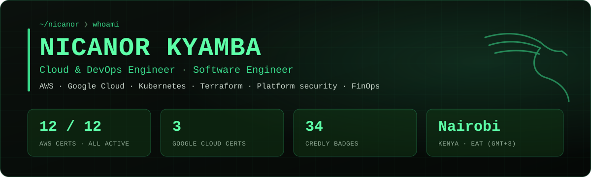
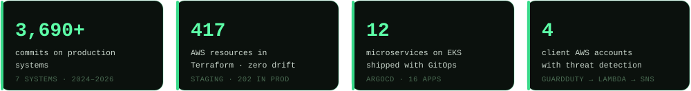
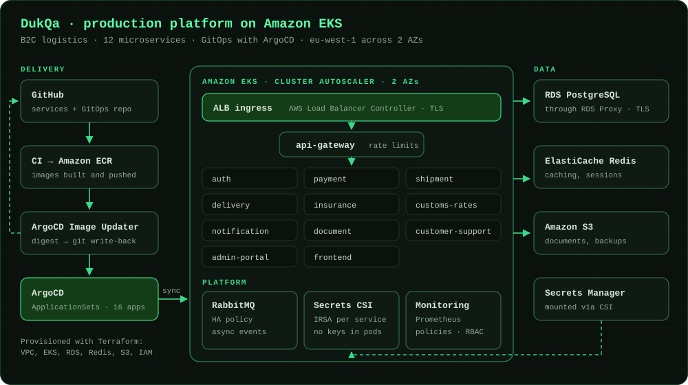
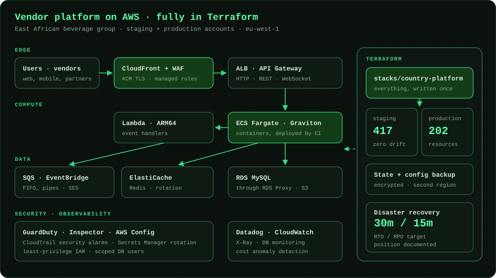
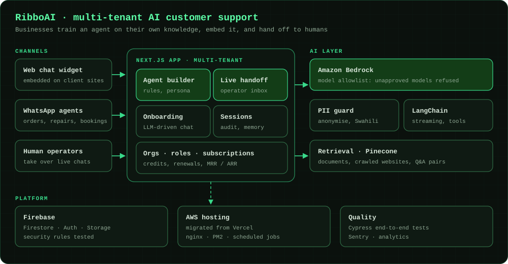
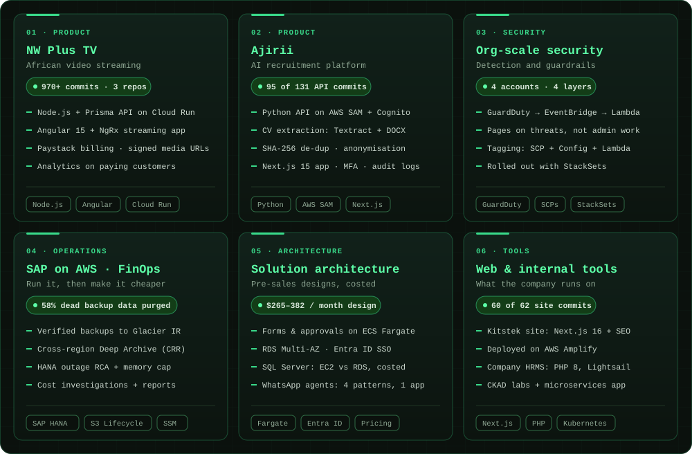
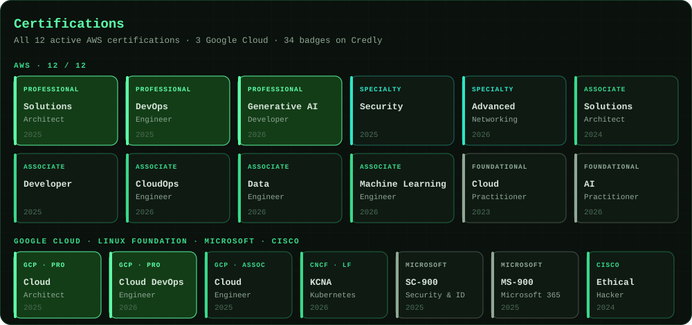

## `$ cat about.md`

I'm a **Cloud & DevOps Engineer** at [Kitsilano Technologies](https://kitstek.com), an AWS Partner in Nairobi. I lead production platforms, from Kubernetes and GitOps to Terraform, security and cost, for products and clients across East Africa, and I write a lot of the software that runs on them: multi-tenant AI products, a video-streaming service, recruitment tooling.

What people get when they work with me: infrastructure that matches what's in git, security that pages on real threats, recovery targets that are written down and designed for, and documentation good enough to hand over.

## `$ ls ~/work --flagship`

### ☸️ DukQa · production platform on Amazon EKS

> **Role** Platform Lead · **Period** Dec 2025 – May 2026 · **Scale** 12 microservices, 16 GitOps apps, 380+ commits

DukQa is a B2C logistics product for East Africa. I led the production platform: **12 microservices on EKS, delivered entirely through GitOps**, and wrote most of the platform code.

- **GitOps end to end:** ArgoCD with ApplicationSets managing 16 applications; ArgoCD Image Updater writes new image digests back to git, so the cluster always matches the repo
- **Scales on demand:** Cluster Autoscaler across node groups in two availability zones; right-sized requests and pinned image digests in production
- **No credentials in pods:** Secrets Store CSI driver with IRSA per service, plus NetworkPolicies, RBAC, priority classes and limit ranges
- **Hard problems, solved and written up:** diagnosed TLS failures between services and RDS Proxy (ACM certificates, not the RDS CA bundle), tuned RabbitMQ to HA with the right memory and topology, and reported to stakeholders on platform health

`EKS` `ArgoCD` `Helm` `Terraform` `RDS Proxy` `RabbitMQ` `Prometheus` `IRSA`

### ☁️ Vendor platform on AWS · fully in Terraform

> **Role** Infrastructure owner · **Period** Apr 2026 – present · **Scale** 619 resources across 2 accounts, 401 of 409 commits

A containerised vendor platform for an East African beverage group, across staging and production accounts. I wrote the Terraform and run the platform.

- **Brought a live estate under code:** 417 staging resources at **zero drift**, including resources others built by hand, adopted without disturbing their live testing; 202 resources in production
- **One stack, many countries:** everything a country runs is written once and deployed through thin per-environment roots, ready for expansion beyond Kenya
- **Recovery designed, not hoped for:** DR position written against a **30-minute RTO / 15-minute RPO**, with state and configuration backed up encrypted to a second region
- **Operated, not just built:** Datadog monitor audits and DB monitoring, RDS Proxy cutover, Redis scaling, credential rotation, cost anomaly detection and weekly reporting

`Terraform` `ECS Fargate` `Graviton` `RDS Proxy` `WAF` `Datadog` `GitHub Actions`

### 🤖 RibboAI · multi-tenant AI customer support

> **Role** Full-stack & AI engineer · **Period** Nov 2025 – Sep 2026 · **Scale** 1,460+ commits

Businesses train an AI agent on their own documents and websites, embed it on their site or in WhatsApp, and hand conversations to a human when needed.

- **Built the agent builder end to end on Amazon Bedrock**, and chose the model on evidence rather than habit
- **Live agent handoff** and **LLM-driven conversational onboarding**, with persistent assistant sessions and an audit trail
- **Security and privacy by default:** a Bedrock model allowlist (unapproved models are refused), a PII anonymisation design for other providers, Swahili-aware privacy detection (*jina, simu, nambari*), and a fix for unverified cross-visitor chat resume
- **Billing that adds up:** subscriptions, credits and renewals credited to the right organisation; MRR / ARR in the admin overview
- **Moved hosting from Vercel to AWS** and wrote the migration and operations guide

`Next.js` `TypeScript` `Amazon Bedrock` `LangChain` `Pinecone` `Firebase` `Cypress`

## `$ ls ~/work --selected`

<b>Read the full write-ups</b>

 

<table>
<tr>
<td width="50%" valign="top">

### 🎬 NW Plus TV · African video streaming

**970+ commits across 3 repos · 2024–2026**

[nwplus.tv](https://www.nwplus.tv) streams African films, documentaries and podcasts. I built most of it end to end.

- Node.js / Express / Prisma API on **Google Cloud Run**, media in Cloud Storage behind signed URLs, Paystack payments
- Angular 15 + NgRx frontend: content, subscriptions, discounts, payment plans, profiles
- Admin analytics on **server-authoritative counts** (paying customers, not just active subscribers)
- GA4 funnel tracking, the Next.js business site and the full technical handover

`Node.js` `Prisma` `Angular` `NgRx` `Cloud Run`

</td>
<td width="50%" valign="top">

### 🧠 Ajirii · AI recruitment platform

**Serverless API (95 of 131 commits) + Next.js app**

Recruiters post jobs, upload CVs in bulk and get extracted, scored and optionally anonymised candidates.

- Python API on **AWS SAM**: Cognito with a Lambda authorizer, DynamoDB, SES, tests
- **CV text extraction** with Textract and DOCX parsing; **SHA-256 de-duplication**
- Anonymisation as an org setting; ML-scoring integration endpoints
- Next.js 15 app: processing pipeline with stage progress, analytics, audit logs, **MFA for admins**

`Python` `AWS SAM` `Cognito` `Textract` `Next.js`

</td>
</tr>
<tr>
<td width="50%" valign="top">

### 🛡️ Security & governance at org scale

- **Threat detection across 4 client AWS accounts:** GuardDuty → EventBridge (severity ≥ 7) → Lambda enricher → SNS. Operator attribution means routine admin work doesn't page, but genuine threats do. Includes deploy and end-to-end verification tooling.
- **AWS Partner tag enforcement in four layers:** SCP hard-block, tag policy, AWS Config auto-remediation and an EventBridge + Lambda safety net, rolled out with CloudFormation StackSets across the organisation.

`GuardDuty` `EventBridge` `Lambda` `SCPs` `AWS Config` `StackSets`

</td>
<td width="50%" valign="top">

### 💰 Operations & FinOps

- **SAP HANA backup automation** for a multi-tenant logistics account: S3 lifecycle to Glacier Instant Retrieval plus a cross-region Deep Archive copy
- **Cost investigations** for client accounts that tripped their budgets: root cause, remediation and a written report each time
- Incident **RCAs**, runbooks, DR positions and weekly client reports

`AWS Backup` `S3 Lifecycle` `Cost Explorer` `Budgets` `Python`

</td>
</tr>
<tr>
<td width="50%" valign="top">

### 📐 Solution architecture & pre-sales

- **Digital forms and approvals platform** for a sugar manufacturer: ECS Fargate behind CloudFront, RDS PostgreSQL Multi-AZ, SSO with Entra ID, data-only DR to a second region, costed at $265–382/month
- **SQL Server migration guide:** EC2 with BYOL vs RDS with BYOM, costed with a clear recommendation
- **WhatsApp AI agent demo** for a 40-company conglomerate: four agent patterns on one platform, with demo sites carrying the live widget

`Solution design` `Cost modelling` `Entra ID SSO` `AWS Pricing`

</td>
<td width="50%" valign="top">

### 🧰 Web & internal tools

- **Kitstek website:** Next.js 16 App Router marketing site with SEO structure and audit, deployed on AWS Amplify (60 of 62 commits)
- **Kitsilano HRMS:** leave management for the whole company, with accrual by cron, role-based access, approvals and email notifications, on AWS Lightsail
- **CKAD lab repository:** structured labs and a microservices practice app for the Certified Kubernetes Application Developer exam

`Next.js 16` `Tailwind` `PHP 8` `MariaDB` `Lightsail` `kubectl`

</td>
</tr>
</table>

Client work is described without client names or internal details. Happy to walk through any of it in conversation.

## `$ cat principles.md`

## `$ cat certifications.yml`

Verify every badge on <a href="https://www.credly.com/users/nicanor-kyamba">Credly</a>.

## `$ which --all tools`

**Cloud & IaC** 

**Containers & delivery** 

**Observability & security** 

**Software & AI** 

## `$ git log --career`

## `$ gh stats`

Most of my work lives in private client and company repositories, so public stats show only part of it.

## `$ ./contact.sh`

**🟢 Open to Cloud, DevOps and Platform Engineering roles: full-time, contract or freelance.** 
Remote, hybrid or on-site · Nairobi, Kenya · EAT (GMT+3)

